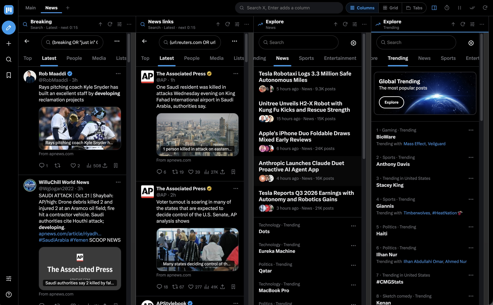
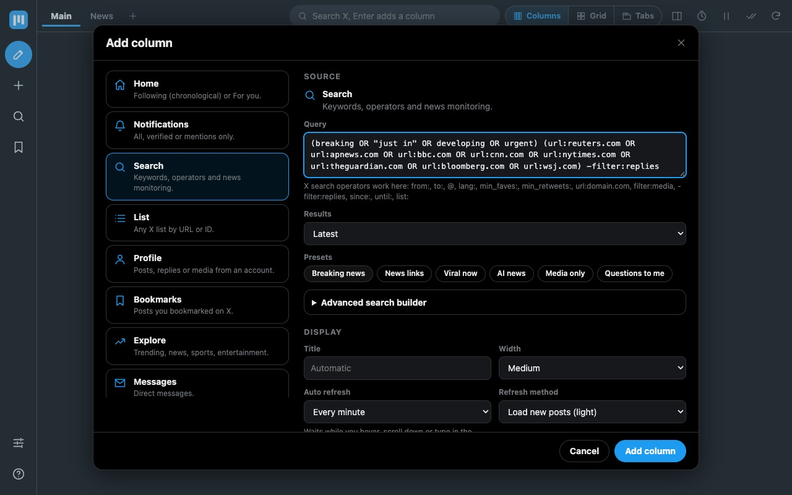
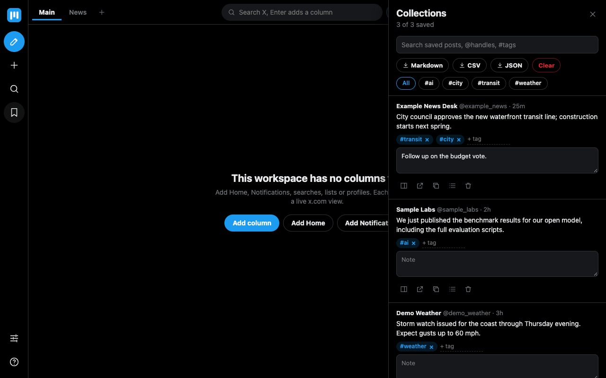

<!--
XDeck
dev.to article source (title, tags, description and cover image are set by scripts/update-devto-article.py at creation and in the dev.to editor afterwards).
Screenshots are the Chrome Web Store images in store/out/, linked at a pinned commit.
Author: Sergio Farfan
-->

For years I read X in TweetDeck: a few searches, a list, notifications and the home timeline side by side, refreshing on their own, nothing recommended to me. Then TweetDeck became X Pro, moved behind a subscription, and I was back to one column and an algorithm deciding what I see.

So I built **XDeck**, a free Chrome extension that turns X into a multi-column deck again. Every column is a live x.com page with your normal login, so likes, replies, media and DMs work exactly as they do on X. Around the columns, XDeck adds what X never did: filters that really hide posts, unread counts, keyword alerts, timed refresh, a reading pane and a place to keep posts that is not X's bookmarks.

> **[Install XDeck from the Chrome Web Store](https://chromewebstore.google.com/detail/xdeck/bhbnoiglolaljelapgkljofdbcfaclcl)**, then click the icon or open `x.com/i/xdeck`. Two workspaces, Main and News, are ready on first launch.

---

## What You Get

- **Columns of anything.** Home (Following or For you), Notifications, searches, lists, profiles, bookmarks, Explore, Messages, communities, likes, or any x.com URL you paste.
- **Three layouts.** Columns, the classic deck; Grid, a news wall that fills the screen; Tabs, one big column at a time for a laptop. Switching never reloads your columns.
- **Workspaces.** "Main" for people, "News" for the world, "Work" for the topics you follow for a living. Import and export them.
- **Filters that hide posts.** Per column: must-include and excluded words (regex allowed), excluded accounts, languages, media only, links only, verified only, hide replies, reposts or quotes, minimum likes. Plus "hide posts already shown in another column", so the same story does not appear four times.
- **Clean X.** Hide promoted posts, "Who to follow", view counts, trends, Premium upsells and Grok buttons. Home opens on the chronological Following tab. Optionally clean normal x.com tabs too.
- **Auto refresh and alerts.** Each column refreshes on its own schedule (15 seconds to an hour) with a countdown in the header, and waits while you are reading it. Unread counters per column, desktop alerts for posts that pass a column's filters.
- **Reading pane.** Click a post and the thread opens on the right; the column stays where it was.
- **Collections.** Save any post with one click, tag it, add a note, search it, export to Markdown, CSV or JSON. Move it to another browser with import.
- **Keyboard.** Alt+1 to Alt+9 focus a column, then X's own keys (j, k, l, r, t) work inside it. Everything else has a shortcut too; press `?`.

The search builder knows X's operators, so a news column is a few clicks: here the **Breaking news** preset, a Latest search for breaking-news words restricted to eight major outlets, refreshing every minute.

---

## How It Works, Briefly

XDeck does not use X's API and has no server. It is x.com, several times, in one tab.

- **The deck lives on x.com itself**, at `x.com/i/xdeck`. The extension stops X's app from loading on that one page and draws the deck instead. Because the deck and its columns are all x.com pages, your login cookies work first-party and nothing has to be copied or stored.
- **X tells browsers not to frame its pages.** While the deck tab is open, a single rule removes that header for x.com pages framed inside that tab, and only there. Normal x.com tabs and every other site keep their headers. The rule disappears when the tab closes.
- **Everything stays in your browser.** Workspaces, filters, settings and saved posts live in Chrome's extension storage. No analytics, no telemetry, no account. The [privacy policy](https://github.com/sergio-farfan/x-deck/blob/main/PRIVACY.md) fits on one page.
- **Minimal permissions.** Storage, notifications, right-click menus, the header rule, and access to x.com only. No "read all sites", no tabs, no cookies.

If you like the plumbing, the [README](https://github.com/sergio-farfan/x-deck#how-it-works) goes into the cookie that forced the deck onto x.com, the one-word CSS fix that made long columns scroll, and why "back" inside a frame is harder than it sounds. It is plain JavaScript, no framework and no build step, with 331 automated checks run against a local stand-in for x.com on every change.

---

## The Honest Limits

- **One X account at a time.** All columns share your browser's X login.
- **Memory.** Each column is a full x.com page. Columns load only when they scroll into view and other workspaces are unloaded, but eight columns are eight copies of X.
- **The deck tab has to stay open** for alerts, unread counts and auto refresh. In the background is fine.
- **X changes its markup now and then.** When it does, filters or Clean X may need a small update; the columns themselves keep working.
- XDeck is an independent, unofficial project, not affiliated with X Corp.

---

## Try It

1. **[Add XDeck to Chrome](https://chromewebstore.google.com/detail/xdeck/bhbnoiglolaljelapgkljofdbcfaclcl)** and pin it to the toolbar.
2. Click the icon, press **Alt+Shift+X**, or open `https://x.com/i/xdeck`. If columns ask you to sign in, log in to x.com once in a normal tab and press Alt+R.
3. Add a column with **+**, pick a layout, open the sliders on a column header for its filters, and press `?` for the shortcuts.

The newest version is always on [GitHub releases](https://github.com/sergio-farfan/x-deck/releases/latest) as a zip you can load unpacked; the store catches up after Chrome's review.

Tell me what your deck looks like and what is missing: [issues on GitHub](https://github.com/sergio-farfan/x-deck/issues) are the place.

---

## Source Code

XDeck is on GitHub: [github.com/sergio-farfan/x-deck](https://github.com/sergio-farfan/x-deck), MIT licensed.

---

*Built with plain JavaScript and Chrome Manifest V3.*
